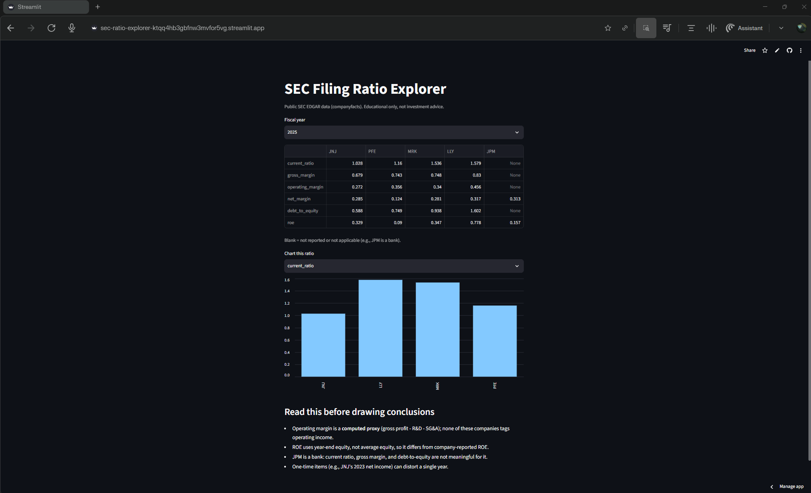

# SEC Filing Ratio Explorer

How do liquidity, profitability, and leverage compare across large pharmaceutical companies, using only public SEC data?

> Educational project. Not investment advice.

## Why it matters
Comparing companies means pulling the same line items from each filing and calculating ratios the same way. Companies often report the same item under different XBRL tags, so this is messier than it looks. This tool pulls public SEC data, computes six standard ratios, and puts the companies side by side, with the data caveats shown next to the numbers.

## Demo
<!-- Add after deploying: Live app: https://your-app-link.streamlit.app/ -->
<!-- Add a screenshot: save it as docs/screenshot.png, then uncomment the next line -->
<!--  -->

Run it locally (see "Run it" below). Pick a fiscal year, view the comparison table, and chart any one ratio.

## How it works
1. **Fetch.** `src/fetch.py` downloads each company's `companyfacts` JSON from SEC EDGAR and caches it in `data/cache/`, so repeat runs don't hit the SEC.
2. **Extract.** `src/extract.py` maps XBRL tags to the line items needed (revenue, cost of sales, R&D, SG&A, current assets and liabilities, net income, equity, debt) and builds one row per fiscal year. It uses fallback tags where companies differ.
3. **Compute.** `src/ratios.py` calculates the six ratios, returning blank where a denominator is zero or missing.
4. **Compare.** `app.py` shows the companies side by side for a chosen fiscal year, with a bar chart per ratio.

Companies: Johnson & Johnson (JNJ), Pfizer (PFE), Merck (MRK), Eli Lilly (LLY), and JPMorgan Chase (JPM) as a deliberate contrast case (a bank, so current ratio, gross margin, and debt-to-equity are not meaningful for it).

| Ratio | Formula |
|---|---|
| Current ratio | current assets / current liabilities |
| Gross margin | (revenue - cost of sales) / revenue |
| Operating margin | operating income / revenue (see proxy note below) |
| Net margin | net income / revenue |
| Debt-to-equity | total debt / stockholders' equity (total debt = loans and notes payable + long-term debt) |
| ROE | net income / year-end stockholders' equity |

## Data
**Public data** from the free SEC EDGAR `companyfacts` API. Cached copies of the five companies are committed in `data/cache/`, so the app runs without a network call.

If you re-fetch, the SEC requires a descriptive User-Agent with contact info. Set it as an environment variable so your email stays out of the repo (see "Run it").

## Results
**Verification against a filing.** I checked Johnson & Johnson's fiscal 2025 numbers from this tool against its 10-K. Eight of eight line items matched (full table in `NOTES.md`):

| Line item | Tool ($B) | 10-K ($B) |
|---|---|---|
| Revenue (sales to customers) | 94.19 | 94.193 |
| Net earnings | 26.80 | 26.804 |
| Earnings before provision for taxes | 32.58 | 32.581 |
| Total current assets | 55.62 | 55.624 |
| Total current liabilities | 54.13 | 54.126 |
| Total shareholders' equity | 81.54 | 81.544 (derived: assets - liabilities) |
| Loans and notes payable (current debt) | 8.50 | 8.495 |
| Long-term debt (noncurrent) | 39.44 | 39.438 |

Only J&J was verified by hand. The other four companies were not checked against their filings.

**Data findings** (details in `NOTES.md`):
- J&J's 2023 net earnings include $21.8B from discontinued operations, so its 2023 net margin and ROE are inflated.
- J&J's 2025 net earnings were boosted by $7.2B of other income, so single-year ratios are noisy.
- J&J switched cost-of-sales tags over time, and its equity is only available under a tag that includes noncontrolling interest.
- Merck reports R&D under a different tag than J&J, which may include acquired in-process R&D and makes operating margin less comparable between the two.

**Tests.** 13 test functions across fetch, extraction, and ratios, including failed downloads and empty filings. Run `python -m pytest` for the current pass count.

## Limitations
- **Operating margin is a proxy.** None of these companies tag operating income, so it is computed as gross profit - R&D - SG&A. That leaves out items like acquired in-process R&D and restructuring.
- **ROE uses year-end equity**, not average equity, so it will differ from company-reported ROE.
- **Debt definition is my choice** (loans and notes payable + long-term debt). Other definitions, such as including leases, would change debt-to-equity.
- **One verified company.** Tag choices for the other four were not checked line by line against their filings.
- **Five companies, one industry, plus one bank.** Not a broad or statistically meaningful sample.
- Ratios alone can hide a lot: one-time items, accounting choices, and business mix.
- Out of scope on purpose: price prediction, buy/sell recommendations, paywalled sources.

## AI assistance
Claude (free chat) acted as a tutor. It explained the structure of the `companyfacts` JSON and the ratios, proposed the file structure, and wrote first drafts of the fetch, extraction, ratio, and app code and tests.

What I did myself: chose the companies and ratio definitions, ran the code and fixed setup problems (including the SEC 403 error, solved with a real User-Agent kept in an environment variable), made the tag and debt-definition decisions documented in `NOTES.md`, and checked J&J's results line by line against its 10-K.

## Run it
Requires Python 3.11+.

```bash
python -m venv .venv
# Windows: .venv\Scripts\activate    Mac/Linux: source .venv/bin/activate
pip install -r requirements.txt
python -m pytest
python -m streamlit run app.py
```

Only needed if you re-fetch data from the SEC (cached data is included):

```bash
# Mac/Linux
export SEC_USER_AGENT="Your Name your.email@example.com"
# Windows PowerShell
$env:SEC_USER_AGENT = "Your Name your.email@example.com"
```
